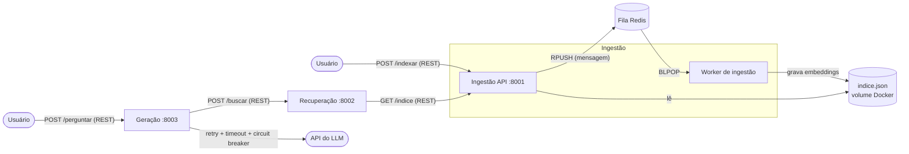

# RAG Distribuído em Microsserviços (C2.A2)

Trabalho individual de Sistemas Distribuídos e Computação em Nuvem (FAESA, 2026/2).
Autor: Caio Borba (`cborba733`).

Um sistema de **perguntas e respostas sobre documentos** (RAG: Retrieval-Augmented
Generation) dividido em três microsserviços independentes. O usuário faz uma pergunta;
o sistema busca os trechos mais parecidos nos documentos indexados e usa um LLM para
montar uma resposta baseada neles.

## Arquitetura



| Serviço | Porta | Responsabilidade |
|---|---|---|
| Ingestão (API) | 8001 | Recebe documentos, coloca na fila e serve o índice |
| Worker de ingestão | - | Consome a fila, gera os embeddings (TF-IDF) e grava o índice |
| Recuperação | 8002 | Dada uma pergunta, devolve os trechos mais parecidos (similaridade de cosseno) |
| Geração | 8003 | Orquestra o fluxo e chama o LLM com proteção contra falhas |
| Redis | 6379 | Fila de mensagens entre a API de ingestão e o worker |

## Fluxo de uma requisição

**Indexar documentos (assíncrono):**

1. O cliente envia os documentos em `POST /indexar` na Ingestão.
2. A API coloca o lote na fila Redis e responde `202 Accepted` na hora.
3. O worker pega o lote da fila, gera os embeddings e grava o `indice.json`.

**Fazer uma pergunta (síncrono):**

1. O cliente envia `POST /perguntar` na Geração.
2. A Geração chama `POST /buscar` na Recuperação (REST).
3. A Recuperação busca o índice na Ingestão (`GET /indice`), calcula a similaridade de
   cosseno entre a pergunta e cada trecho e devolve os `top_k` melhores.
4. A Geração monta o contexto e chama o LLM (protegido por retry, timeout e circuit breaker).
5. A resposta volta ao cliente com o texto, o contexto usado e as fontes (arquivo e score).

## Comunicação entre os serviços

- **REST (JSON sobre HTTP)** entre Geração, Recuperação e Ingestão. Escolhi REST pela
  simplicidade e porque o corpo das mensagens é pequeno; não há necessidade de streaming
  nem de contratos binários que justifiquem gRPC.
- **Mensageria (Redis)** na etapa de ingestão. Gerar embeddings é a parte mais pesada, então
  a API só enfileira e responde `202`. Se o worker estiver fora do ar, as mensagens ficam
  esperando na fila e são processadas quando ele volta (a API não cai junto). Lotes que
  falham 3 vezes vão para a fila `fila_ingestao_falhas` (dead-letter).

## Resiliência

| Proteção | Onde | Comportamento |
|---|---|---|
| Timeout | chamada ao LLM (`LLM_TIMEOUT`, padrão 20 s) | Não deixa a requisição presa esperando o LLM |
| Retry com backoff | Geração (`LLM_TENTATIVAS`, padrão 3) | Tenta de novo esperando 0,5 s, 1 s, 2 s... |
| Circuit breaker | Geração | Após 3 falhas seguidas abre por 20 s e recusa as chamadas na hora (`503`) |
| Degradação | Geração | LLM falhou: `502` devolvendo o contexto recuperado. Recuperação fora: `503` com mensagem clara. Sem chave de API: modo simulado, que funciona offline |
| Idempotência | Worker | Reenviar o mesmo documento não duplica no índice |

A chave do LLM **nunca fica no código**: vem da variável de ambiente `LLM_API_KEY`
(arquivo `.env`, que está no `.gitignore` e no `.dockerignore`).

## Como rodar do zero

Pré-requisitos: Git, Docker com Docker Compose e Python 3 (só para o script que envia os
documentos).

```bash
git clone https://github.com/cborba733/sd-2026-2-kit-c2a2.git
cd sd-2026-2-kit-c2a2

# 1. sobe Redis, ingestão, worker, recuperação e geração (a primeira vez demora alguns minutos)
docker compose up -d --build

# 2. espera os serviços iniciarem
sleep 15

# 3. envia os documentos da pasta documentos/ (precisa do pacote requests)
python3 -m venv .venv
source .venv/bin/activate
pip install requests
python scripts/indexar_documentos.py     # deve imprimir: 202 {'enfileirados': 3}

# 4. faz uma pergunta
curl -s -X POST localhost:8003/perguntar -H 'content-type: application/json' \
  -d '{"pergunta":"O que diz o teorema CAP?"}'
```

Para usar um LLM de verdade, copie `.env.example` para `.env`, preencha `LLM_API_KEY` e
rode `docker compose up -d` de novo. Sem chave, o sistema roda em **modo simulado**.

Para desligar: `docker compose down` (use `docker compose down -v` para apagar também o índice).

## Configuração (variáveis de ambiente)

| Variável | Padrão | Uso |
|---|---|---|
| `LLM_API_KEY` | vazio (modo simulado) | Chave da API do LLM |
| `LLM_API_URL` / `LLM_MODELO` | ver `.env.example` | Endereço e modelo do LLM |
| `LLM_TIMEOUT` | 20 | Tempo máximo (s) de uma chamada ao LLM |
| `LLM_TENTATIVAS` / `LLM_ESPERA_BASE` | 3 / 0.5 | Retry e espera inicial do backoff |
| `URL_INGESTAO` / `URL_RECUPERACAO` | localhost:8001 / 8002 | Endereços entre os serviços (o compose já ajusta) |
| `REDIS_URL` | redis://localhost:6379/0 | Endereço da fila |
| `INDICE_PATH` | dados/indice.json | Onde o índice é gravado |

## Testes

Com tudo no ar, `bash scripts/testar_fluxo.sh` roda três casos: pergunta dentro dos
documentos, pergunta fora deles (responde que não encontrou) e pergunta vazia (`400`).

Para ver as proteções funcionando:

```bash
# Recuperação fora do ar -> a Geração responde 503 sem quebrar
docker compose stop recuperacao
curl -s -w " %{http_code}\n" -X POST localhost:8003/perguntar -H 'content-type: application/json' -d '{"pergunta":"teorema CAP"}'
docker compose start recuperacao

# Worker parado -> a ingestão continua aceitando (202) e a mensagem espera na fila
docker compose stop worker
python scripts/indexar_documentos.py
curl -s localhost:8001/saude        # "na_fila": 1
docker compose start worker         # a fila volta a 0
```

## Decisões e limitações

- Embeddings TF-IDF (scikit-learn) com uma lista de palavras comuns do português ignoradas.
  É simples e roda offline, mas não entende sinônimos como um modelo de embeddings neural.
- O índice é um arquivo JSON em um volume Docker compartilhado entre ingestão e worker.
  A escrita é atômica (arquivo temporário + `os.replace`). Serve para poucos documentos.
- A cada lote o worker recalcula os vetores de todo o índice, porque o vocabulário do TF-IDF
  muda quando entram documentos novos.

## Estrutura

```
documentos/            textos que serão indexados
scripts/               indexar_documentos.py e testar_fluxo.sh
servicos/comum/        código compartilhado (embeddings, fila, índice, LLM, circuit breaker, log)
servicos/ingestao/     API de ingestão + worker + Dockerfile
servicos/recuperacao/  serviço de recuperação + Dockerfile
servicos/geracao/      serviço de geração + Dockerfile
docker-compose.yml     orquestra os 5 containers
```
